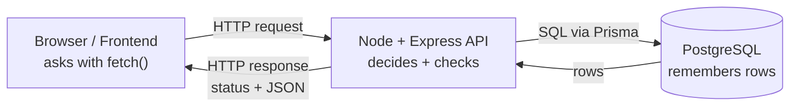

# TaskFlow — Node.js Backend Course

> **From `fetch` works to “I ship APIs”.** A free, project-based backend course for frontend developers. No CS degree assumed.

[](https://nodejs.org/en/docs)
[](https://expressjs.com/en/5x/api.html)
[](https://www.postgresql.org/docs/current/tutorial.html)
[](https://www.prisma.io/docs/orm/v7/core-concepts/supported-databases/postgresql)
[](./lessons/0001-course-map.html)
[](https://ismailanajar.github.io/nodejs-course/)

**🌐 Live site:** https://ismailanajar.github.io/nodejs-course/ — start at [0001 Course Map](./lessons/0001-course-map.html).

---

## What is this?

One continuous project — **TaskFlow**, a task-management API — grows every module:

`CLI → raw HTTP server → Express API → PostgreSQL → auth → tested + documented → deployed`

Each lesson is **one sitting, one win**: a beautiful page with Mermaid diagrams, runnable code, an instant-feedback quiz, and an instructor answer key.



## Modules + lessons

| Module | Lessons | You will be able to… |
|--------|---------|----------------------|
| **0 — Orientation** | [0001 Course map](./lessons/0001-course-map.html) | Draw the whole backend journey; syllabus + milestones |
| **1 — How the Web Works** | [0002](https://ismailanajar.github.io/nodejs-course/lessons/0002-http-request-and-response.html) · [0003](https://ismailanajar.github.io/nodejs-course/lessons/0003-urls-localhost-and-ports.html) · [0004](https://ismailanajar.github.io/nodejs-course/lessons/0004-json-and-api-contracts.html) · [0005 checkpoint](https://ismailanajar.github.io/nodejs-course/lessons/0005-module-1-checkpoint.html) | Read any request/response, URL, JSON contract; triage failures |
| **2 — Node.js Fundamentals** | [0006](https://ismailanajar.github.io/nodejs-course/lessons/0006-run-js-outside-the-browser.html) · [0007](https://ismailanajar.github.io/nodejs-course/lessons/0007-files-taskflow-v0.html) · [0008](https://ismailanajar.github.io/nodejs-course/lessons/0008-npm-and-modules.html) · [0009](https://ismailanajar.github.io/nodejs-course/lessons/0009-env-vars-and-errors.html) · [0010](https://ismailanajar.github.io/nodejs-course/lessons/0010-async-and-event-loop.html) · [0011 checkpoint](https://ismailanajar.github.io/nodejs-course/lessons/0011-module-2-checkpoint.html) | Run scripts, persist files, use npm, env config, event loop |
| **3 — Server From Scratch** | [0012](https://ismailanajar.github.io/nodejs-course/lessons/0012-first-listening-server.html) · [0013](https://ismailanajar.github.io/nodejs-course/lessons/0013-routing-by-hand.html) · [0014](https://ismailanajar.github.io/nodejs-course/lessons/0014-request-bodies-and-post.html) · [0015](https://ismailanajar.github.io/nodejs-course/lessons/0015-file-behind-http.html) · [0016 checkpoint](https://ismailanajar.github.io/nodejs-course/lessons/0016-module-3-checkpoint.html) | Raw `node:http` CRUD API with correct statuses |
| **4 — Express + REST** | [0017](https://ismailanajar.github.io/nodejs-course/lessons/0017-express-hello.html) · [0018](https://ismailanajar.github.io/nodejs-course/lessons/0018-middleware-and-errors.html) · [0019](https://ismailanajar.github.io/nodejs-course/lessons/0019-zod-validation.html) · [0020](https://ismailanajar.github.io/nodejs-course/lessons/0020-structure-and-paging.html) · [0021 checkpoint](https://ismailanajar.github.io/nodejs-course/lessons/0021-module-4-checkpoint.html) | Middleware, Zod, structure, paging — same API, less code |
| **5–8** | _in progress_ | PostgreSQL → auth → tests → deploy |

📖 [Course glossary](./reference/glossary.html) · 🗺️ [Full syllabus in lesson 0001](./lessons/0001-course-map.html)

## Stack (verified Oct 2026)

Node 24 LTS · Express 5 · PostgreSQL 16/17 · Prisma ORM 7 · Zod · argon2/bcrypt · Node test runner + Supertest · Docker

## Run it locally

```bash
git clone https://github.com/ismailanajar/nodejs-course.git
cd nodejs-course
# lessons are static HTML — just open one:
start lessons/0001-course-map.html
# or serve the whole site:
npx serve .
```

Lesson code demos need only **Node 24+**, zero dependencies (until `nanoid`/`express`/`zod` where the lesson says so).

## Repo structure

```text
nodejs-course/
  index.html            # landing page (GitHub Pages root)
  lessons/0001-*.html   # 21 lessons (self-contained, portfolio style)
  reference/glossary.html
  assets/styles.css     # shared 1:1 portfolio-mirror stylesheet
  assets/quiz.js        # reusable instant-feedback quiz widget
  sitemap.xml / robots.txt / .nojekyll
```

## Author

Built by **[Ismail Anajar](https://ismail-anajar.vercel.app/)** — Full-Stack Developer (React, Next.js, Node.js), Casablanca.

- 🌐 Portfolio: https://ismail-anajar.vercel.app/
- 💻 GitHub: https://github.com/ismailanajar
